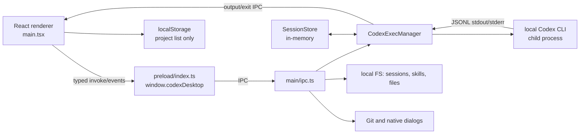

# Existing architecture

## Verified lifecycle

`src/main/main.ts` constructs one `SessionStore` and one `CodexExecManager`, registers IPC before Electron becomes ready, and creates a single `BrowserWindow` after `app.whenReady()`. Development loads `ELECTRON_RENDERER_URL`; packaged builds load `dist/renderer/index.html`. The window uses a preload bridge, `contextIsolation: true`, and `nodeIntegration: false`; it does **not** use Electron sandboxing (`sandbox: false`). New windows are denied and their URLs are handed to the OS.

## Responsibilities and persistence

| Area | Verified implementation | Persistence / boundary |
|---|---|---|
| Renderer | One 1,847-line `src/renderer/main.tsx` owns view, composer, project, transcript, model, menus and errors. Helper modules isolate pure presentation/state logic. | Browser localStorage stores only project list/active ID. |
| Main process | `ipc.ts` exposes dialogs, history, skills, project files, Git, images, bootstrap and session control. | Privileged local process. IPC handlers do not authorize callers or validate most argument shapes. |
| Preload | Explicit `contextBridge` facade; no direct Node access in renderer. | Good separation, but bridge exposes broad local-path operations. |
| Sessions | `SessionStore` is a `Map`; it retains messages/session state only for the current app process. | Not durable; CLI JSONL is the practical historical source. |
| Projects | Renderer adds selected paths and writes them to localStorage. First-run candidates derive from CLI history. | No project database, metadata, sharing, workspace, or cloud sync. |
| History | `codexHistory.ts` recursively scans `~/.codex/sessions`, parses JSONL metadata, then filters by cwd. Opening a history reads/parses its full file again. | CLI-owned local files. |
| Skills | `skillStore.ts` recursively finds `SKILL.md` under `~/.codex/skills` and `~/.codex/superpowers/skills`; disabled IDs are JSON in `~/.codex/disabled-skills.json`. | Discovery/management only; no install workflow and no runtime enforcement. |

## Codex execution

`sendInput()` resolves a local `codex` executable, builds a fixed argument vector and uses `spawn` without a shell. New turns use `codex exec --json`; follow-ups use `codex exec resume --json <conversation-id> <prompt>`. `codexEvents.ts` maps selected JSONL event types to assistant/system transcript chunks; `CodexExecManager` emits them through IPC. Models are discovered with `codex debug models`, falling back to a hard-coded `gpt-5.5` entry. Reasoning is translated to Codex configuration. The default CLI sandbox is `workspace-write`; the UI initializes the selection as `full-access`, which emits Codex's dangerous bypass flag.

`projectFiles.ts` and `gitBranches.ts` are helpers only: file listing is recursive with a 2,000 item cap and an ignored-directory list; Git reads branch/status/diff statistics and can run `git switch`.

## Coupling assessment

Reusable: React visual primitives, Markdown/activity rendering, composer attachment references, local project/file/Git browsing patterns, process-event abstraction, and the narrow preload convention.

Tightly coupled to Codex: command construction, model discovery, JSONL parsing assumptions, `~/.codex` history/skills locations, one CLI conversation ID per session, and CLI permission flags. The app is a local single-user CLI wrapper, not an agent platform or shared service.

## Important unverified behavior

No automated Electron UI, packaged-app, real-Codex, or macOS crash tests exist. Passing unit tests therefore verifies helpers, not end-to-end interaction or CLI protocol compatibility.
