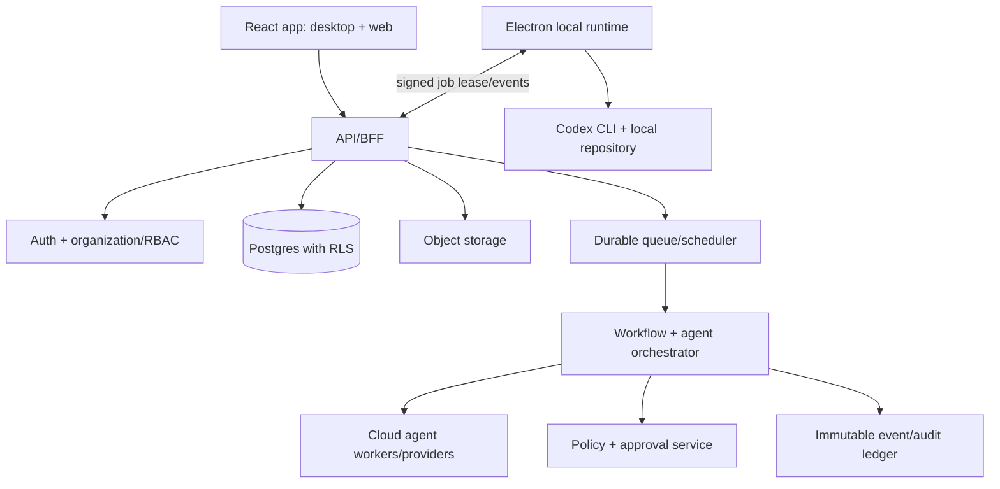

# Gwira refoundation recommendation

Gwira should evolve from this client, not be a rebrand of its local state. Preserve the coding-agent experience behind a compatibility boundary while moving shared business state and authorization to a service.

| Category | Components | Rationale / effort |
|---|---|---|
| Keep | Typed preload pattern; command builder/platform resolver; Markdown/activity UI helpers; tests; project/file/Git interaction patterns | Useful desktop foundations. Harden and modularize. Low–medium. |
| Extend | React transcript/composer; Codex execution manager; local skill discovery; project selector; session/event model | Convert to provider/runtime adapters and task/run views. Medium–high. |
| Rebuild | Global history scanning; in-memory session persistence; permission model; monolithic `main.tsx`; localStorage projects; automation/settings placeholders | Not safe/scalable for organizations or durable work. High. |
| Add | Organizations/memberships/RBAC, workspaces, tasks, teams, workflow engine, inbox, approvals, secrets/integrations, documents, notifications, audit/runs, reporting/billing | Required product core. High, phased. |

## Target architecture

Supabase is compatible as an initial hosted Postgres/Auth/Storage/realtime foundation if tenant isolation is enforced with tested RLS and service-role credentials never reach renderer/desktop clients. It does not replace a server-side orchestration/API layer for privileged workflows, provider keys, webhooks, scheduling and approval enforcement. React view code can be reused selectively after separating browser-safe components from Electron calls; the current app is not directly web-deployable because most capabilities assume the local machine.

Organizations are the mandatory tenant root. Every row and object has an organization ID, membership-derived authorization and audit actor; database RLS is defense in depth, not the only check. Tasks create durable runs. Runs hold input/versioned instructions, scoped tool grants, model/provider usage, artifacts and event stream. Any spend, external communication, destructive action, data export, payment or broad credential use requires a policy decision and, where required, a human approval that is bound to an exact action payload.

For industry flexibility, make domain work “applications” over shared primitives (records/tasks/runs/files/inbox/workflows), rather than placing marketing, finance and software logic in one agent abstraction.
